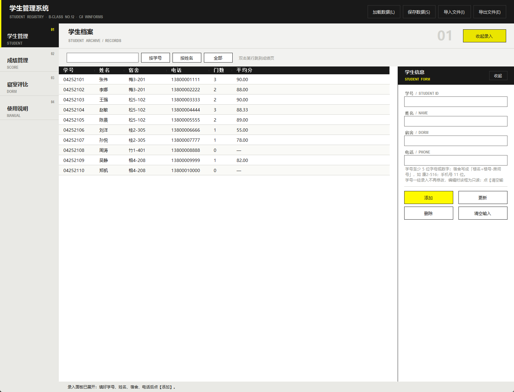
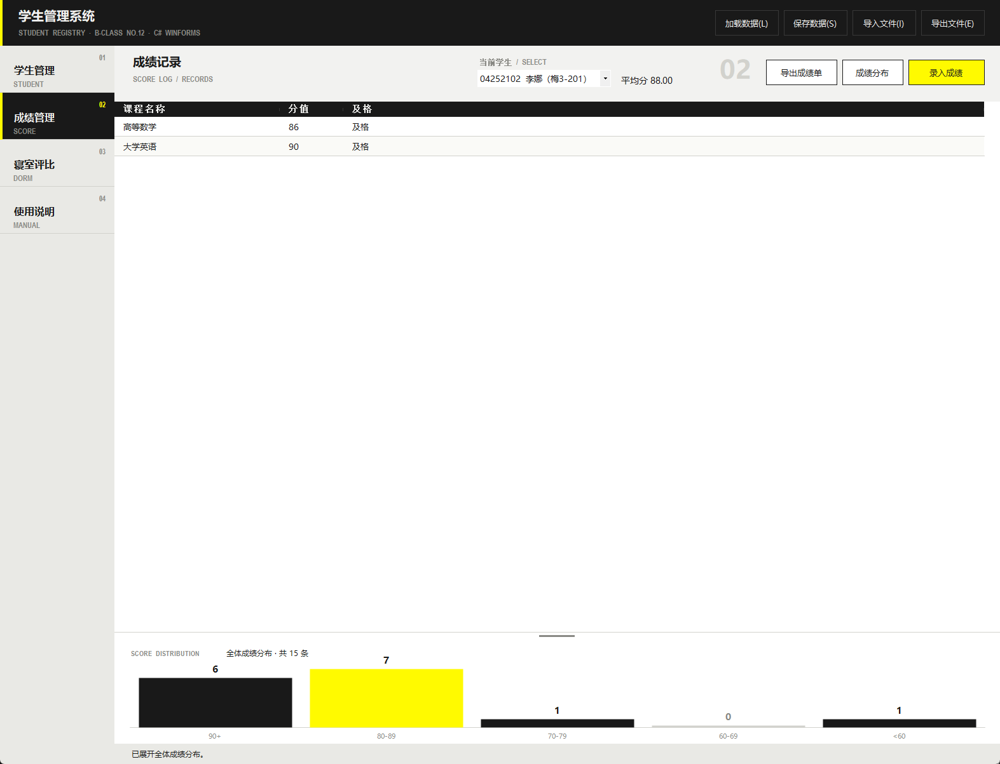
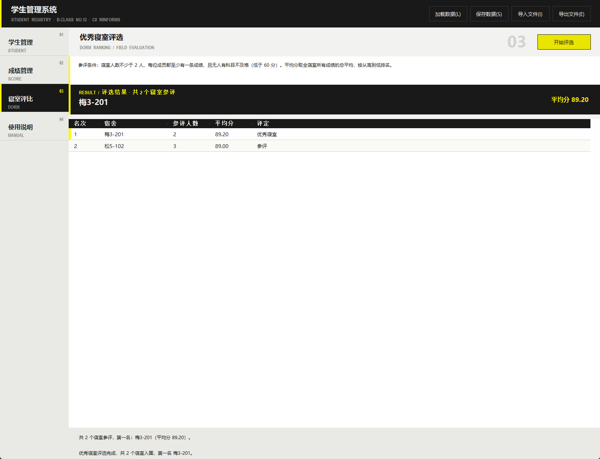

# Ark UI · WinForms

把 [Ark UI](https://github.com/Brandon030722/ark-ui-skill) 的 **endfield** 风格族做成了 Windows Forms 能直接用的控件集。
炭黑作墨、米白作纸、信号黄只给主操作和选中状态，全部方角、自绘、零第三方依赖。

A WinForms implementation of the **endfield** family from [Ark UI](https://github.com/Brandon030722/ark-ui-skill).
Square geometry, charcoal-on-paper palette, one signal yellow accent, no third-party dependencies.



> 截图来自使用本控件集实现的学生管理系统（课程设计作业）。Demo 工程的界面长得类似，跑起来看更直接。

---

## 它是什么

一套可以直接 `using ArkUi;` 的界面语言，包含 6 个公开类型：

| 类型 | 作用 |
|---|---|
| `ArkTheme` | 配色、字体、两色线性混合。改配色只改这一个文件 |
| `ArkAnim` | 共享一个 Timer 的补间引擎，控件悬停和面板滑动都走它 |
| `ArkButton` | 三种形态的方角按钮：`Tool` / `Primary` / `Ghost` |
| `ArkRailItem` | 左侧导航项，三行排版：编号 / 中文标题 / 英文小标 |
| `ArkListView` | 黑表头、斑马纹、信号黄选中行，最后一列自动拉伸 |
| `ArkGrip` | 可拖动改面板高度的水平抓手，常用于图表区 |

外加一个 `ArkRule`（1px 分隔线），和 Demo 里的 `ArkDrawer`（右侧抽屉滑入）。

界面骨架的五个数字也一起固定下来了：顶栏 72、左导航 180、内容区自适应、状态条 30、抽屉 356。



## 快速开始

**要求**：Windows + Visual Studio 2015 及以上（工程是经典非 SDK 格式，目标框架 .NET Framework 4.6.1）。

```bash
git clone https://github.com/<your-name>/ark-ui-winforms.git
cd ark-ui-winforms
start ArkUiWinForms.sln
```

把 `demo` 设为启动项目，F5 就能看到三个页面：列表、组件标本、关于。
想看真实项目里的效果，可以翻 `screenshots/`。

在自己的工程里用：

```csharp
// 1. 引用 ArkUi.csproj，或者直接拷 src/ArkUi 下的 .cs
// 2. 顶栏
Panel top = new Panel { Dock = DockStyle.Top, Height = 72, BackColor = ArkTheme.Ink };

ArkButton save = new ArkButton
{
    Text = "保存",
    Kind = ArkButtonKind.Tool,
    Width = 96, Height = 32, Top = 20, Left = 900
};

// 3. 主操作按钮
ArkButton submit = new ArkButton
{
    Text = "提交",
    Kind = ArkButtonKind.Primary,
    Width = 120, Height = 36
};

// 4. 左侧导航项
ArkRailItem item = new ArkRailItem
{
    IndexText = "01",
    Caption = "学生管理",
    Micro = "STUDENT",
    Dock = DockStyle.Fill
};
item.IsActive = true;

// 5. 列表
ArkListView lv = new ArkListView { Dock = DockStyle.Fill, FillLastColumn = true };
lv.Columns.Add("学号", 110);
lv.Columns.Add("姓名", 120);
lv.SignalRowIndex = 0;   // 第一名左边给一条常驻黄竖条
```

## 设计 token

| 角色 | 色值 | 用在哪 | 不用在哪 |
|---|---|---|---|
| 墨 Ink | `#191919` | 顶栏、表格表头、导航选中项、标题文字 | 大面积铺在内容区 |
| 纸 Paper | `#F2F2F0` | 内容区底色、空行分隔、导航未选中态 | 当强调色用 |
| 信号黄 Signal | `#FFFA00` | 主操作按钮、当前导航项、第一名标记 | 普通文字、次要按钮 |
| 校验绿 Verify | `#00FFA2` | 状态栏「已保存」这类落盘提示 | 任何装饰性场合 |

中性派生色：`Rail #E9E9E5`、`RailHover #DEDED8`、`Line #D2D2CD`、`Muted #8A8A85`、
`Panel #FFFFFF`、`RowAlt #FAFAF7`、`Hover #2E2E2E`、`LineDark #383838`。

字体三档：`Display`（微软雅黑 Bold，标题与大号编号）、`Body`（微软雅黑 Regular，正文）、
`Micro`（Arial Narrow Bold，全大写英文小标）。

尺寸：窗体 1180×760，最小 1180×660；左边距 24；表格行高 30；圆角 0~2；分隔线 1px。

完整规范见 [DESIGN.md](DESIGN.md)。



## 几个刻意的决定

**不要圆角。** WinForms 默认按钮是 2px 圆角加渐变的系统样式，和这套语言不搭。
`ArkButton` 整只重画：填充、1px 描边、左侧 3px 信号条，全部手绘。

**悬停是渐变不是反色。** 鼠标划过去 110ms 内颜色连续变化，离开 150ms 淡回去。
用的不是控件自己的 Timer，是 `ArkAnim` 里那个共享 Timer，所有动画一趟回调里跑完。

**文字在 `OnDrawItem` 里一次画完，不用 `OnDrawSubItem`。**
Details 视图下这两个事件的触发顺序不稳定，分开画会出现背景盖掉第 2 列以后文字的情况。

**最后一列拉伸要"抖"一下。** 直接设宽度不会触发重算，横向滚动条会赖着不走。
先设成目标值 ±1 再设回来，强制 ListView 重新计算滚动范围。

**导航的黄竖条是独立浮层。** 不画在 `ArkRailItem` 里，切页时从上一项滑到下一项，一条 Panel 就够了。

## 目录结构

```
ark-ui-winforms/
├─ ArkUiWinForms.sln
├─ src/ArkUi/                  控件库（Library，.NET Framework 4.6.1）
│   ├─ ArkTheme.cs             配色 / 字体 / Blend
│   ├─ ArkAnim.cs              补间引擎
│   ├─ ArkButton.cs            三种按钮 + ArkButtonKind
│   ├─ ArkRailItem.cs          导航项
│   ├─ ArkListView.cs          列表
│   ├─ ArkRule.cs              分隔线 + ArkGrip
│   └─ Properties/AssemblyInfo.cs
├─ demo/                       演示程序（WinExe）
│   ├─ Program.cs
│   ├─ DemoForm.cs             三个演示页
│   └─ ArkDrawer.cs            右侧抽屉（示例，不在库里）
├─ screenshots/
├─ DESIGN.md                   设计规范与实现约定
└─ LICENSE
```

## 出处与致谢

**设计语言来自 [Ark UI](https://github.com/Brandon030722/ark-ui-skill)**，作者 [@Brandon030722](https://github.com/Brandon030722)。

- 本项目使用 Ark UI 的 **`endfield` 风格族** + **第 3 档 `complex` 应用深度**。
- Ark UI 是一套基于公开设计证据、采用 clean-room 方法实现的界面设计与前端工作流。
  它的风格族（`ark` / `endfield` / `exa` / `popucom` / `corporate`）只描述从公开页面归纳出的
  构图、色彩、排版、几何和动效规律。
- 本仓库是 Ark UI 设计语言在 **Windows Forms** 上的独立实现，**不是** Ark UI 官方产物，
  也与任何游戏或厂商无关。仓库内不含受保护的标志、角色立绘、宣传图或生产环境代码。
- 上表里的色值取自 Ark UI 的 `assets/tokens/ark-ui.tokens.json`（`themes.endfield`），
  剩余的中性色是按这套规律推出来的。

**代码来源**：从作者自己的课程设计项目「学生管理系统」（C# / WinForms / .NET Framework 4.6.1）里抽出来，
去掉业务逻辑，补上注释和 Demo。抽的时候刻意的原则是：库只管"长什么样、怎么响应鼠标"，
不碰任何数据模型。

如果你要用 Ark UI 的原版（HTML / CSS / React），去原仓库；如果你要 Web 端而不是 WinForms，也用原仓库。

## 已知限制

- 只测过 Windows 10 / 11 与 .NET Framework 4.6.1，没在 Mono 或 .NET 6+ 上验证。
- `Micro` 字体用 Arial Narrow，系统没有时会回退成普通 Arial，英文小标会略宽。
- 没有做高 DPI 的逐像素适配，125% / 150% 缩放下尺寸按系统缩放走，不做二次修正。
- 深色模式不做。这套语言本身就是"浅底 + 黑顶栏"，换深色会破坏信号黄的对比关系。

## License

代码 MIT，见 [LICENSE](LICENSE)。设计语言归 Ark UI 原作者，本仓库只做实现，不声明对其拥有权利。
